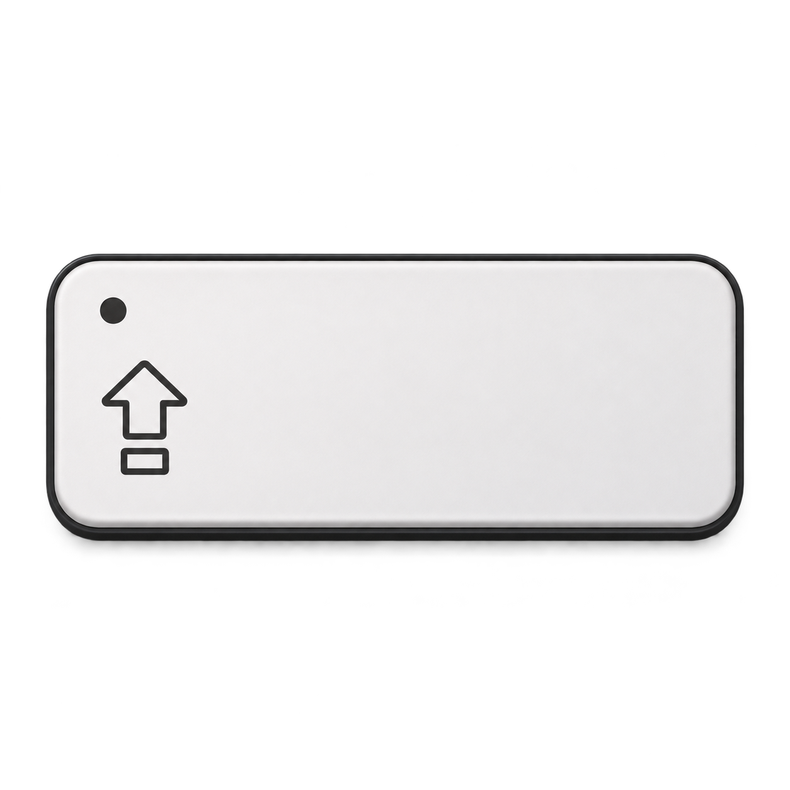

# Caps Lock Remap

<p align="center">
  
</p>

Turn Caps Lock into an extra modifier key on Windows 11. Hold it to send **Ctrl + Alt + Shift**, or choose your own combination. Optionally assign a separate action to a quick tap.

For example, **Caps Lock + S** sends **Ctrl + Alt + Shift + S**, ready for shortcuts configured in PowerToys or other applications. Caps Lock Remap supplies the key combination; your shortcut manager decides what it does.

> **Early prototype:** input handling and the tray interface are implemented, but real-world keyboard, PowerToys, and sleep/wake validation is still pending. Automatic startup and detection of silently removed keyboard hooks are not implemented yet.

## Features

- Configurable hold modifiers: Ctrl, Alt, Shift, and Windows.
- Optional tap action: Escape, Tab, Enter, Backspace, Space, or no action.
- Adjustable tap threshold, from 50 to 1,000 milliseconds; default is 200 ms.
- Another key press or a longer hold cancels the tap action.
- Modifier tracking designed to preserve keys you are physically holding.
- Tray controls for enabling/disabling, settings, retrying input handling, and exiting.
- Manual restart as administrator for use with elevated desktop applications.
- Settings saved in your Windows user profile.
- Portable, framework-dependent executable built with C# and Windows Forms.

The default configuration holds Ctrl + Alt + Shift and does nothing on a tap. While enabled, Caps Lock does not toggle capitalization. Disabling remapping restores ordinary Caps Lock behavior.

## Requirements

- Windows 11, x64.
- [.NET 10 Desktop Runtime for Windows x64](https://dotnet.microsoft.com/en-us/download/dotnet/10.0). Choose the **Desktop Runtime**, which includes Windows Forms support.

The app uses the installed runtime rather than bundling it, keeping the executable small. No application installer is required. Settings are stored separately in your user profile.

## Getting started

1. Obtain `CapsLockRemap.exe` from a release, if available, or build it using the instructions below.
2. Exit any AutoHotkey script or other remapper that also handles Caps Lock.
3. Run `CapsLockRemap.exe`. Settings open on the first launch.
4. Select your hold modifiers and optional tap action, then choose **Save**.
5. Configure the corresponding modifier combination in PowerToys or your preferred shortcut manager.

The app stays in the system tray when you close Settings. If the icon is hidden, check the tray overflow menu.

For shortcuts in administrator applications, right-click the tray icon and choose **Restart as administrator…**. Windows will request approval. This does not provide input access to UAC prompts or other secure-desktop screens.

## Tray controls

| Control | Action |
| --- | --- |
| Enabled | Toggle Caps Lock remapping |
| Settings… | Change hold modifiers, tap action, and timing |
| Retry input handling | Reset input state and reinstall the keyboard hook |
| Restart as administrator… | Relaunch with elevated privileges |
| Exit | Release app-owned modifiers and quit |

Double-click the tray icon to open Settings. Its tooltip reports enabled, disabled, non-elevated, or error status. Disabled and error states use distinct system icons.

## Settings and removal

Configuration is saved to:

```text
%LOCALAPPDATA%\CapsLockRemap\settings.json
```

To remove the prototype, exit it from the tray and delete the executable. Delete the settings folder as well if you want to remove your preferences. The current version does not register startup tasks or change system keyboard mappings.

## Known limitations

- **Not yet validated for daily use.** The automated checks cover state transitions, not actual Windows input delivery.
- Sleep/resume and lock/unlock reset handling is implemented, but repeated lid, power, and session transitions still need testing on real hardware.
- Windows can silently remove a keyboard hook. Automatic detection of that condition is not implemented; the tray may still appear enabled. Use **Retry input handling** if mapping stops working.
- The app cannot remap keys while its process is stopped. Unexpected termination may leave injected modifier state behind.
- Start with Windows, automatic crash recovery, and diagnostic logging remain planned work.
- A second launch reports that an instance is already running rather than opening its Settings window.
- Remote Desktop, virtual machines, games, and ARM64 are outside the initial supported scope.

See the [design and acceptance checklist](docs/design.md) for implementation status, reliability boundaries, and planned work.

## Build from source

Install the .NET SDK selected by [global.json](global.json): **10.0.404**, or a later patch in the same feature band. Build on Windows x64. Visual Studio and separate C++ build tools are not required.

From the repository root in PowerShell:

```powershell
# Build
 dotnet build CapsLockRemap.slnx -c Release

# Run the app
 dotnet run --project src/CapsLockRemap

# Run the deterministic state-transition checks
 dotnet run --project tests/CapsLockRemap.StateTests -c Release

# Publish the framework-dependent single-file executable
 dotnet publish src/CapsLockRemap/CapsLockRemap.csproj -p:PublishProfile=Portable
```

Published output:

```text
artifacts/win-x64/CapsLockRemap.exe
```

The Portable profile targets Windows x64, embeds debug symbols, and excludes the .NET runtime. Build artifacts are ignored by Git. Publishing does not launch the app or configure startup.

Ten transition checks currently cover repeat suppression, tap behavior, physical modifier overlap, reset behavior, and input-injection failure. Manual Windows integration testing remains necessary.

## Contributing

Read [docs/design.md](docs/design.md) before changing behavior. Keep its implementation status and acceptance checklist current, and include relevant build and validation results with changes.

When reporting an input problem, include your Windows version, whether the app was elevated, your hold/tap settings, any other keyboard remappers in use, and steps to reproduce. Do not include sensitive text or personal shortcut contents.
